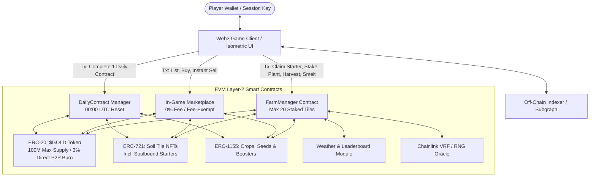
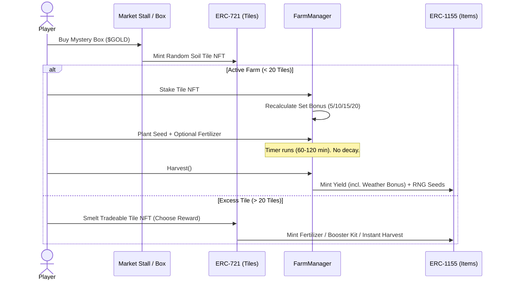

# Game Design Document (GDD): Web3 Soil & Crop Farming Game (v1.2)

## 1. Core Concept & Game Loop
A stress-free, blockchain-based farming and resource management game set in a cozy isometric pixel-art world. Players acquire land tiles (NFTs), cultivate 5 distinct crops across 3 soil rarity tiers, optimize yields using permanent and temporary boosters, smelt excess tiles for power-ups, fulfill daily story contracts, and trade assets on a zero-fee decentralized in-game marketplace.

* **Core Loop:** Claim Starter Pack -> Plant Seeds -> Apply Fertilizer (Optional) -> Wait (60–120 mins, no crop decay) -> Harvest Crops + Bonus Seeds -> Mill Seeds / Sell at Market Stall / Complete 1 Daily Contract -> Acquire Mystery Boxes & Specialize Farm (Max 20 Active Tiles).

---

## 2. Onboarding & Starter Pack
* **Free Soulbound Starter Pack:** Every new player wallet can claim **1–2 Soulbound (non-transferable) Common Soil Tiles** along with **matching starting seeds** for those specific tiles. This ensures zero-cost entry and immediate gameplay without risking initial liquidity drain.
* **Soulbound Rules:** Soulbound starter tiles count toward the 20-tile farm cap and can be dismissed/replaced once the player acquires tradeable NFT tiles, but they cannot be sold on the marketplace or smelted for booster items.

---

## 3. System Architecture & Component Communication

### 3.1 Smart Contract & Off-Chain Architecture

### 3.2 Tile Lifecycle & Smelting Sequence

---

## 4. Token Standards & Asset Definitions

### 4.1 Token Architecture
* **`$GOLD` (ERC-20):** Primary utility currency (100,000,000 Max Supply). Features a **0% fee** inside official game contracts and a **3% burn fee** on direct wallet-to-wallet P2P transfers.
* **`SoilTiles` (ERC-721):** Unique land plots with on-chain attributes:
  * `cropType` (0–4: Wheat, Potato, Rice, Watermelon, Wine)
  * `rarity` (0: Common, 1: Uncommon, 2: Rare)
  * `isSoulbound` (boolean: true for starter tiles)
  * `hasPermanentBoost` (boolean)
  * `plantedAt` (timestamp) & `isFertilized` (boolean)
* **`FarmItems` (ERC-1155):** Multi-token contract holding fungible assets:
  * `ID 1–5`: Harvested Crops
  * `ID 11–15`: Crop Seeds
  * `ID 21`: Temporary Fertilizer (+20% yield, 1 cycle)
  * `ID 22`: Standard Permanent Booster Kit (Usable on Common/Uncommon)
  * `ID 23`: Master Permanent Booster Kit (Usable on Common/Uncommon/Rare)
  * `ID 24`: Global Instant Harvest Scroll (Completes all active timers immediately)

---

## 5. Soil Types & Crop Progression

| Crop | Common Soil (100% Yield) | Uncommon Soil (125% Yield) | Rare Soil (150% Yield) |
| :--- | :--- | :--- | :--- |
| **Wheat** | Brown Soil | Loess Soil | **Black Soil (Chernozem)** |
| **Potatoes** | Sandy Loam | Peat Soil | **Volcanic Soil (Andosol)** |
| **Rice** | Wetland / Marsh | Clay Soil | **Alluvial Silt** |
| **Watermelon** | Desert Sand | River Sand | **Terra Rossa** |
| **Wine** | Rocky Soil | Limestone | **Slate** |

---

## 6. Economy & Balancing Tables

### 6.1 Crops, Timers & Pricing (Base = Common Soil, 10 Units Yield)
*Note: Unharvested crops remain on the tile indefinitely until harvested (zero decay).*

| Crop | Growth Time | Seed Price (Market) | Base Yield (Common) | Base Sell Price / Unit | Base Revenue | Net Profit (Market Seed) | Permanent Boost Cost (15x Net) | Temp. Fertilizer Cost (20% Rev) |
| :--- | :--- | :--- | :--- | :--- | :--- | :--- | :--- | :--- |
| **Wheat** | 60 min | 20 $GOLD | 10 | 5 $GOLD | 50 $GOLD | +30 $GOLD | 450 $GOLD | 10 $GOLD |
| **Potatoes** | 75 min | 30 $GOLD | 10 | 7 $GOLD | 70 $GOLD | +40 $GOLD | 600 $GOLD | 14 $GOLD |
| **Rice** | 90 min | 45 $GOLD | 10 | 10 $GOLD | 100 $GOLD | +55 $GOLD | 825 $GOLD | 20 $GOLD |
| **Watermelon** | 105 min | 60 $GOLD | 10 | 13 $GOLD | 130 $GOLD | +70 $GOLD | 1,050 $GOLD | 26 $GOLD |
| **Wine** | 120 min | 80 $GOLD | 10 | 17 $GOLD | 170 $GOLD | +90 $GOLD | 1,350 $GOLD | 34 $GOLD |

### 6.2 Seed Acquisition Mechanics (High-Variance Balancing)
1. **Direct Harvest Drop (RNG upon harvest):**
   * **Common Tile:** 10% chance for `1x Seed` (Avg: 0.10).
   * **Uncommon Tile:** 20% chance for `1x Seed` (Avg: 0.20).
   * **Rare Tile:** 20% chance for `1x Seed` + 20% chance for `2x Seeds` (40% total chance, Avg: 0.60).
2. **Hand-Crank Seed Mill (No tools required):**
   * Convert `1x Harvested Crop` -> **25% chance** for `0 Seeds`, **35% chance** for `1x Seed`, **40% chance** for `2x Seeds` (**Avg: 1.15 seeds per crop**).
   * *Design Intent:* High variance and a 1.15 average keep the NPC Seed Counter relevant as a reliable `$GOLD` sink while rewarding lucky extractions.
3. **Market Purchase:** Buy directly from the infinite NPC Seed Counter for `$GOLD`.

---

## 7. Boosters, Farm Limit & Set Bonuses

### 7.1 Additive Yield Formula
`Total Yield = Base Yield (10) * (1 + RarityBonus + PermBoost + TempFertilizer + SetBonus + WeatherBonus)`

* **Rarity Bonus:** Common `+0%` | Uncommon `+25%` | Rare `+50%`
* **Permanent Tile Boost:** `+20%` (Purchased via `$GOLD` or applied via Booster Kit)
* **Temporary Fertilizer:** `+20%` (Consumed on harvest)
* **Weather Event Bonus:** Variable (e.g., `+10%` to `+15%` for affected crops during active events)

### 7.2 Active Farm Limit (Max 20 Tiles) & Specialization Set Bonuses
A player can stake a maximum of **20 Soil Tiles** in their `FarmManager` contract. Having multiple tiles of the **same crop type** (regardless of rarity) grants a permanent specialization bonus to all tiles of that crop:
* **5 Tiles of same crop:** `+5%` Yield
* **10 Tiles of same crop:** `+10%` Yield
* **15 Tiles of same crop:** `+15%` Yield
* **20 Tiles of same crop (Monoculture Master):** `+25%` Yield

---

## 8. Mystery Boxes & Tile Smelting (Deflationary Sink)

### 8.1 Mystery Boxes
* **Standard Seed Box (250 $GOLD):** 75% Common | 22% Uncommon | 3% Rare
* **Premium Geology Box (900 $GOLD):** 40% Common | 45% Uncommon | 15% Rare

### 8.2 Tile Smelting Mechanics (Tradeable NFTs Only)
* **Smelt Common Tile:** Grants `1x Temporary Fertilizer`.
* **Smelt Uncommon Tile (Player chooses 1):**
  * Option A: `3x Temporary Fertilizers`
  * Option B: `1x Standard Permanent Booster Kit` (Works on Common or Uncommon tiles)
* **Smelt Rare Tile (Player chooses 1):**
  * Option A: `1x Global Instant Harvest Scroll` (Finishes growth on all active tiles instantly)
  * Option B: `1x Master Permanent Booster Kit` (Works on all tiles, including Rare)

---

## 9. Marketplace & Daily Story Contracts

### 9.1 Marketplace & Transfer Fee Structure
1. **NPC Base Floor:** Sell harvested crops to the system treasury at fixed base prices (`5` to `17 $GOLD`).
2. **Official In-Game Marketplace (0% Fee):** Escrow orderbook inside the Wooden Market Stall allowing players to trade ERC-721 Soil Tiles and ERC-1155 crops/seeds with **zero protocol fees**.
3. **Direct Wallet-to-Wallet P2P Transfers (3% Burn Fee):** Any direct transfer of `$GOLD` (or external NFT marketplace royalty) outside whitelisted game contracts incurs a **3% fee** that is permanently burned (`0x000...dEaD`).

### 9.2 Daily Story Contracts (Global 00:00 UTC Reset)
* **Global Reset:** Every day at **00:00 UTC**, 3 story-driven parchment contracts are pinned to the Old Farm Tree globally for all players:
  * **Slot 1:** Guaranteed **Tier 1** (Bronze Wax Seal)
  * **Slot 2:** **Tier 2 or Tier 3** (Silver Wax Seal)
  * **Slot 3:** **Tier 4 or Tier 5** (Gold Wax Seal)
* **Completion Limit:** Players may complete **only ONE (1) contract per 24-hour cycle**, creating a strategic choice between accessible payouts and high-tier Mystery Box chances.

| Tier | Required Crops (Example) | Base Value | Contract Payout (+20%) | Mystery Box Reward Chance |
| :--- | :--- | :--- | :--- | :--- |
| **Tier 1** | 30x Wheat | 150 $GOLD | **180 $GOLD** | **20%** (Standard Box) |
| **Tier 2** | 40x Potatoes + 20x Wheat | 380 $GOLD | **456 $GOLD** | **40%** (Standard Box) |
| **Tier 3** | 50x Rice + 30x Watermelon | 890 $GOLD | **1,068 $GOLD** | **60%** (Standard Box) |
| **Tier 4** | 80x Wine + 40x Potatoes | 1,640 $GOLD | **1,968 $GOLD** | **80%** (70% Standard / 10% Premium) |
| **Tier 5** | 120x Wine + 80x Watermelon + 60x Rice | 3,680 $GOLD | **4,416 $GOLD** | **100%** (75% Standard / 25% Premium) |

---

## 10. Endgame & Live-Ops Features
* **Global Weather Events:** Dynamic multi-day weather cycles (e.g., *Monsoon Season: +15% Rice Yield*, *Mediterranean Heatwave: +15% Wine & Watermelon Yield*) that visually alter the farm, boost specific crop yields, and drive P2P trading.
* **Seasonal Leaderboards:** Ranked ladders tracking total `$GOLD` earned from contracts, total crops harvested, and Tier-5 contracts completed, awarding cosmetic badges and seasonal titles.
* **Achievements System:** Permanent milestones (e.g., *"Black Soil Baron"*, *"Slate Grand Cru Master"*, *"Smelt 50 Tiles"*) unlocking profile titles and farm decorations.

---

## 11. Visual Direction & UI/UX Concept

### 11.1 Art Style & Perspective
* **Isometric Pixel Art:** Cozy, warm, hand-crafted 2D isometric pixel art inspired by *Stardew Valley*, featuring rich earthy color palettes, subtle wind animations, and distinct visual textures for all 15 soil types (e.g., glossy dark Chernozem, layered blue-grey Slate, vibrant Terra Rossa).
* **Dynamic Weather Overlays:** Active global weather events visually transform the farm scene (e.g., gentle rain particles during Monsoon Season, warm golden sunlight during Heatwaves).

### 11.2 Isometric Farm Grid & Sorting
* **20-Tile Isometric Plot:** All staked tiles (up to 20) are displayed simultaneously on a central farm clearing.
* **Instant Grid Sorting:** Players can dynamically rearrange the visual order of their staked tiles via a wooden toolbar:
  * *Sort by Crop Type* (visually groups tiles to highlight active Set Bonuses)
  * *Sort by Rarity* (Rare -> Uncommon -> Common)
  * *Sort by Status* (Ready to Harvest -> Growing -> Empty)
* **On-Tile Visual Cues:**
  * *Rarity Borders:* Plain dirt edge (Common), cobblestone border (Uncommon), ornate stone/timber frame (Rare).
  * *Permanent Boost:* Visible mini-sprinkler or golden soil marker on the tile corner.
  * *Temporary Fertilizer:* Darkened moist soil texture with subtle sparkle particles.

### 11.3 Interactive World Buildings (Diegetic UI)
* **Wooden Farmers Market Stall:** A rustic timber market booth with a striped fabric awning and wooden crates. Houses tabs for the NPC Floor Shop, Seed Counter, Mystery Boxes, and the **0%-Fee In-Game Marketplace** (while direct wallet-to-wallet P2P transfers outside the market incur the **3% `$GOLD` burn fee**).
* **Hand-Crank Seed Mill:** A wooden workbench featuring a manual crank mill and burlap sacks. Dropping a crop into the mill triggers a crank animation and pops out 0, 1, or 2 seeds with distinct visual/audio feedback.
* **Old Farm Tree with Pinned Parchments (Daily Contracts):** A large, gnarled oak tree next to the market stall where 3 parchment scrolls (with Bronze, Silver, and Gold wax seals) are pinned daily at 00:00 UTC.
* **The Stone Smelter / Furnace (Tile Burning):** A brick-and-stone smelting furnace with a glowing firebox and chimney at the edge of the clearing, where excess tradeable Tile NFTs are smelted into Fertilizer, Booster Kits, or Instant Harvest Scrolls.

---

## 12. Open Design Questions & Backlog
* **[CRITICAL] Multi-Accounting & Sybil Resistance:** Because the starter pack (1–2 Soulbound Common Tiles + seeds) is free and farms are capped at 20 tiles, malicious actors could spin up multiple wallets to bypass the 20-tile cap or farm Tier-1 daily contracts repeatedly. Potential solutions to evaluate before mainnet launch:
  * Proof-of-Humanity / Gitcoin Passport / Social Verification gating for the free starter pack.
  * Requiring a minimal gas/protocol fee or small `$GOLD` stake to claim starter assets.
  * Making rewards from Soulbound starter tiles non-withdrawable until the player acquires at least one tradeable NFT tile.
