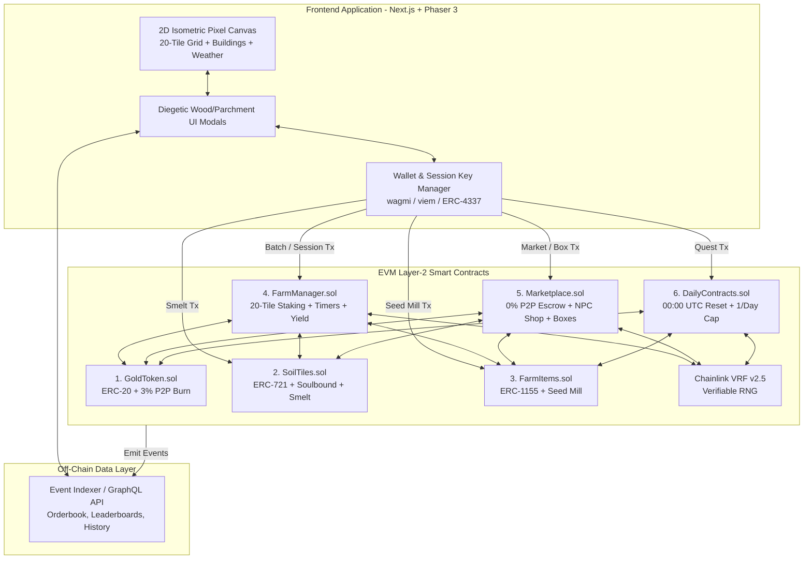

# Technical Design Document (TDD): Web3 Soil & Crop Farming Game

## 1. System Architecture Overview

To achieve a smooth, *Stardew Valley*-like isometric experience without constant wallet popups or high gas fees, the game uses a **Hybrid Web3 Architecture** deployed on an EVM Layer-2 network (e.g., Base, Polygon, or Arbitrum):
* **On-Chain Layer (Solidity Smart Contracts):** Authoritative source of truth for token balances (`$GOLD`), NFT ownership (`SoilTiles`), fungible inventory (`FarmItems`), staking limits (max 20 tiles), timers, RNG, and escrow marketplace trades.
* **Indexing Layer (The Graph / Ponder):** Listens to Smart Contract events (`TileStaked`, `CropHarvested`, `OrderCreated`, `TileSmelted`) to serve fast GraphQL queries for the 0%-fee marketplace orderbook, leaderboards, and player history.
* **Client Layer (React + Phaser 3 / PixiJS):** Renders the 2D isometric farm canvas, weather overlays, and diegetic UI modals (Market Stall, Hand-Crank Mill, Oak Tree Contracts, Stone Smelter) connected via `wagmi` / `viem` and Account Abstraction (Session Keys) for frictionless gameplay.



---

## 2. Smart Contract Architecture (6 Core Contracts)

### 2.1 `GoldToken.sol` (ERC-20 Utility Currency)
* **Inherits:** `ERC20`, `Ownable`
* **Supply:** Fixed `100,000,000 * 10**18` minted at deployment (50M to `TreasuryPool`, 50M distributed per Whitepaper vesting).
* **Fee Logic (`_update` hook):**
  * Checks `mapping(address => bool) public isFeeExempt;` (contains `FarmManager`, `Marketplace`, `DailyContracts`, DEX LP router).
  * If `isFeeExempt[from] || isFeeExempt[to]`, fee = **0%**.
  * Otherwise (direct wallet-to-wallet P2P transfer), **3%** is sent to `0x000000000000000000000000000000000000dEaD` and **97%** to `to`.

### 2.2 `SoilTiles.sol` (ERC-721 Land NFTs)
* **Inherits:** `ERC721Enumerable`, `ERC2981` (3% external royalty), `AccessControl`
* **On-Chain Struct:**
  ```solidity
  struct TileData {
      uint8 cropType;          // 0: Wheat, 1: Potato, 2: Rice, 3: Watermelon, 4: Wine
      uint8 rarity;            // 0: Common, 1: Uncommon, 2: Rare
      bool isSoulbound;        // True for Starter Pack tiles
      bool hasPermanentBoost;  // +20% permanent yield flag
  }
  mapping(uint256 => TileData) public tileInfo;
  ```
* **Key Functions:**
  * `mintStarterTiles(address player)`: Mints 1–2 Soulbound Common tiles (`isSoulbound = true`) + starter seeds. Can only be called once per wallet.
  * `mintTile(address to, uint8 cropType, uint8 rarity)`: Callable only by `Marketplace` (Mystery Boxes).
  * `_update(...)` override: Reverts if `tileInfo[tokenId].isSoulbound == true` and `from != address(0)` and `to != address(0)` (prevents trading, allows burning/dismissing).
  * `smeltTile(uint256 tokenId, uint8 rewardChoice)`: Burns tradeable NFT (`isSoulbound == false`) and calls `FarmItems.mintReward()`:
    * Common (`0`): Mints `1x Temp Fertilizer (ID 21)`.
    * Uncommon (`1`): Choice `0` $\rightarrow$ `3x Temp Fertilizer`, Choice `1` $\rightarrow$ `1x Standard Booster Kit (ID 22)`.
    * Rare (`2`): Choice `0` $\rightarrow$ `1x Global Instant Harvest Scroll (ID 24)`, Choice `1` $\rightarrow$ `1x Master Booster Kit (ID 23)`.

### 2.3 `FarmItems.sol` (ERC-1155 Crops, Seeds & Consumables)
* **Inherits:** `ERC1155`, `AccessControl`
* **Token ID Mapping:**
  * `1–5`: Harvested Crops (Wheat, Potato, Rice, Watermelon, Wine)
  * `11–15`: Crop Seeds
  * `21`: Temporary Fertilizer (+20% yield, 1 cycle)
  * `22`: Standard Permanent Booster Kit (Common/Uncommon)
  * `23`: Master Permanent Booster Kit (All rarities)
  * `24`: Global Instant Harvest Scroll
* **Key Functions:**
  * `millSeeds(uint8 cropIndex, uint256 amount)`: Burns `amount` of Crop (`ID 1–5`) and uses VRF/RNG to mint `0` (25%), `1` (35%), or `2` (40%) Seeds (`ID 11–15`) per crop milled (avg 1.15).

### 2.4 `FarmManager.sol` (Core Gameplay & Staking Engine)
* **State Variables:**
  * `uint256 public constant MAX_TILES = 20;`
  * `mapping(address => uint256[]) public stakedTiles;`
  * `mapping(uint256 => uint64) public plantedAt;` (`0` = empty)
  * `mapping(uint256 => bool) public isFertilized;`
  * `uint8 public activeWeatherEvent;` & `uint16 public weatherBonusBps;` (Admin/Oracle controlled live-ops).
* **Key Functions (Batch-Enabled for UX):**
  * `stakeTile(uint256 tokenId)` / `unstakeTile(uint256 tokenId)`
  * `plantBatch(uint256[] calldata tokenIds, bool[] calldata applyFertilizer)`: Burns required seeds + optional fertilizers (`ID 21`) and sets `plantedAt[tokenId] = block.timestamp`.
  * `harvestBatch(uint256[] calldata tokenIds)`: Verifies `block.timestamp >= plantedAt + growthDuration`. Calculates total yield using additive formula (Base 10 + Rarity + PermBoost + Fertilizer + SetBonus [5/10/15/20 tiles] + WeatherEvent). Mints crops and rolls RNG bonus seeds (10% / 20% / 40%). Resets `plantedAt = 0`.
  * `applyPermanentBoost(uint256 tokenId, bool useKit)`: Either deducts `15x Net Profit` in `$GOLD` (recycled to Treasury) or burns `ID 22` / `ID 23` kit to set `hasPermanentBoost = true`.
  * `useInstantHarvestScroll()`: Burns `1x ID 24` and sets `plantedAt` of all currently growing staked tiles to `1` (instantly harvestable).

### 2.5 `Marketplace.sol` (0%-Fee P2P Escrow, NPC Floor & Mystery Boxes)
* **NPC Modules (100% `$GOLD` Recycled to Treasury Reward Pool):**
  * `sellCropsToNPC(uint256 cropId, uint256 amount)`: Burns ERC-1155 crops and transfers fixed `$GOLD` (`5` to `17`).
  * `buyNPCItem(uint256 itemId, uint256 amount)`: Sells infinite Seeds (`ID 11–15`) and Temp. Fertilizer (`ID 21`) for `$GOLD`.
  * `openMysteryBox(uint8 boxType)`: Charges `250 $GOLD` (Standard) or `900 $GOLD` (Premium), requests VRF randomness, and mints a new `SoilTile` NFT.
* **0%-Fee P2P Orderbook:**
  * `listTile(uint256 tokenId, uint256 priceGold)` / `buyTile(uint256 listingId)`: Escrows ERC-721 and transfers 100% of `$GOLD` to seller (0% fee).
  * `listItems(uint256 itemId, uint256 amount, uint256 pricePerUnit)` / `buyItems(uint256 orderId, uint256 amount)`: Escrows ERC-1155 crops/seeds for player-to-player trading with 0% fee.

### 2.6 `DailyContracts.sol` (00:00 UTC Story Quests)
* **Daily Cycle Logic:** `uint256 currentDay = block.timestamp / 86400;` (automatically resets at `00:00 UTC`).
* **State:**
  * `mapping(uint256 => Quest[3]) public dailyQuests;` (Slot 0: Tier 1, Slot 1: Tier 2–3, Slot 2: Tier 4–5).
  * `mapping(address => uint256) public lastCompletedDay;`
* **Key Function:**
  * `completeQuest(uint8 slotIndex)`: Requires `lastCompletedDay[msg.sender] < currentDay`. Burns required ERC-1155 crops, pays out `Base Value * 1.20` in `$GOLD` from Treasury, and rolls Mystery Box drop chance (20% to 100%). Sets `lastCompletedDay[msg.sender] = currentDay`.

---

## 3. Frontend & UI Technical Architecture

### 3.1 Recommended Tech Stack
* **Framework:** Next.js 14+ (App Router) + TypeScript + Tailwind CSS (for HUD & overlay windows).
* **Isometric Game Engine:** **Phaser 3** (embedded as a full-screen canvas component) for smooth 60 FPS tile rendering, sprite animations, weather particle systems, and clickable world buildings.
* **Web3 & Gasless UX:** `wagmi` + `viem` + **Session Keys** (e.g., Privy / ZeroDev / Biconomy ERC-4337). Players sign *once* upon login, allowing one-click planting, harvesting, and milling without repeated MetaMask popups.

### 3.2 Isometric Canvas & Building Hitboxes
The main game screen is a single interactive isometric farm scene (`1920x1080` responsive viewport with zoom/pan):

1. **Central Farm Clearing (4×5 Isometric Grid = 20 Slots):**
   * Renders staked `SoilTiles` using isometric diamond sprites (`128x64 px` base tile size).
   * **Layered Tile Rendering:**
     * *Layer 1 (Base Soil):* 15 distinct pixel textures (Brown, Loess, Black Soil, Slate, Terra Rossa, etc.).
     * *Layer 2 (Rarity Frame):* Dirt rim (Common), Cobblestone (Uncommon), Ornate Gold/Timber (Rare).
     * *Layer 3 (Boosters):* Mini-sprinkler sprite (`hasPermanentBoost`) + wet/sparkle shader (`isFertilized`).
     * *Layer 4 (Crop Sprite):* 4 visual states (`Empty` -> `Seedling` -> `Growing` -> `Ripe + Floating Golden Sickle Icon`).
   * **Client-Side Visual Sorting:** Clicking *Sort by Crop / Rarity / Status* reorders the `stakedTiles` array locally in browser state (zero gas cost) and smoothly animates the tiles into grouped positions so Set Bonuses (5/10/15/20) are visually obvious.

2. **Interactive Diegetic World Buildings (Clickable Sprites with Hover Outlines):**
   * **Wooden Market Stall (Top-Left):** Opens the *Market Modal*.
   * **Old Oak Tree with Parchments (Next to Market):** Displays 3 visual parchment sprites pinned to the trunk (Bronze, Silver, Gold seals). Clicking opens the *Daily Story Contract Modal*.
   * **Hand-Crank Seed Mill (Bottom-Left):** Opens the *Seed Mill Modal*.
   * **Stone Smelting Furnace (Bottom-Right):** Animated glowing fire; opens the *Tile Smelter Modal*.

### 3.3 UI Components & HUD Specification

| UI Component | Screen Position | Functionality & Data Displayed |
| :--- | :--- | :--- |
| **Top Resource Bar** | Top Center/Left | `$GOLD` balance, Active Weather Event banner (e.g., *Monsoon +15% Rice*), Active Set Bonuses pills (e.g., *Wine 10/20: +10%*), Wallet/Session status. |
| **Quick-Action Dock** | Bottom Center | Batch buttons: **[Harvest All Ready]**, **[Plant All Empty]**, **[Fertilize All]**, and **Grid Sort Dropdown** (Crop / Rarity / Status). |
| **Tile Inspector Drawer** | Right Slide-Over | Opens when clicking any single tile: shows Soil Type, Rarity, exact Yield breakdown math, remaining timer, and **[Buy Permanent Boost]** button. |
| **Market Stall Modal** | Center Overlay | Wooden frame UI with 4 tabs: **1. Sell Harvest (NPC)**, **2. Seed & Fertilizer Shop**, **3. Mystery Boxes** (animated crate opening), **4. P2P Orderbook (0% Fee)** with filters for Tile Crop/Rarity. |
| **Seed Mill Modal** | Center Overlay | Drag-and-drop or slider to select crop quantity -> **[Turn Crank]** button triggers pixel crank animation + popup showing exact `0 / 1 / 2` seed drops. |
| **Oak Tree Quest Modal** | Center Overlay | Displays the 3 daily story parchments with NPC portraits, flavor text, required crop progress bars, `+20% $GOLD` payout, Mystery Box odds, and `00:00 UTC` countdown timer. |
| **Stone Smelter Modal** | Center Overlay | Lists unstaked, tradeable NFT tiles from wallet. Selecting a tile shows the 2 reward choices (e.g., *3x Fertilizer* vs. *Booster Kit*) and **[Smelt Tile]** confirmation. |
| **Inventory & Trophy Bag** | Top-Right Icon | Slide-out wooden chest showing unstaked Tiles, Crops, Seeds, Booster Kits, Instant Harvest Scrolls, Achievements, and Seasonal Leaderboard rank. |

---

## 4. Development Roadmap (Suggested Implementation Phases)

1. **Phase 1: Smart Contracts & Unit Tests (Foundry / Hardhat)**
   * Implement `GoldToken`, `SoilTiles`, `FarmItems`, and `FarmManager`.
   * Write comprehensive Foundry tests verifying the additive yield formula, 20-tile cap, Soulbound restrictions, and 3% P2P burn exemptions.
2. **Phase 2: Marketplace, Quests & VRF Integration**
   * Implement `Marketplace` (0% escrow + Mystery Boxes) and `DailyContracts` (`00:00 UTC` modulo logic).
   * Connect Chainlink VRF v2.5 on testnet (e.g., Base Sepolia).
3. **Phase 3: Isometric Art Assets & Phaser 3 Grid**
   * Generate/draw the 15 isometric soil tiles, 5 crop growth sheets, and 4 interactive buildings.
   * Build the 4×5 isometric grid with client-side sorting and batch action triggers.
4. **Phase 4: Diegetic Modals, Indexer & Session Keys**
   * Build the wooden/parchment React UI modals, connect Subgraph for the P2P orderbook, and integrate ERC-4337 Session Keys for one-click farming.
