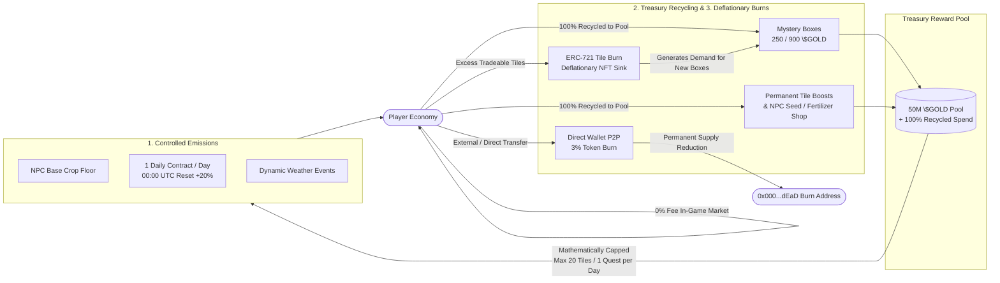

# Whitepaper: Economic Design & `$GOLD` Tokenomics (v1.1)

## 1. Executive Summary
The game economy is built on a sustainable, closed-loop Web3 model designed to prevent hyperinflation while rewarding active strategic gameplay. By combining a hard-capped utility token (**`$GOLD`**), scarce land NFTs (**`SoilTiles`**), non-transferable starter assets, and fungible agricultural commodities (**`FarmItems`**), the ecosystem aligns player incentives with long-term economic stability.

---

## 2. Token Overview & Supply Allocation

**`$GOLD`** is a fixed-supply ERC-20 utility token deployed on an EVM-compatible Layer-2 network. No minting function exists beyond the initial genesis supply of **100,000,000 `$GOLD`**.

* **Token Name:** Gold
* **Ticker:** `$GOLD`
* **Standard:** ERC-20 (with Whitelisted Transfer Fee Hook)
* **Max Supply:** `100,000,000 $GOLD`

### 2.1 Token Distribution & Vesting Schedule

| Allocation Category | Share (%) | Token Amount (`$GOLD`) | Vesting & Release Terms |
| :--- | :--- | :--- | :--- |
| **Gameplay & Farm Rewards** | **50%** | 50,000,000 | Locked in the Treasury Reward Pool. Released dynamically via NPC crop sales and Daily Story Contracts. |
| **DEX Liquidity (LP)** | **20%** | 20,000,000 | Paired at TGE (Token Generation Event) to ensure deep liquidity. LP tokens locked for 24+ months. |
| **Team & Development** | **15%** | 15,000,000 | **12-month cliff**, followed by linear monthly vesting over **24 months**. |
| **Treasury & Ecosystem** | **10%** | 10,000,000 | Reserved for future game expansions, seasonal events, audits, and strategic partnerships. |
| **Community & Airdrops** | **5%** | 5,000,000 | Distributed to early adopters, testnet participants, and launch marketing campaigns. |

---

## 3. The Three Pillars of Economic Sustainability

To avoid the "infinite emission death spiral" common in early Play-to-Earn games, `$GOLD` relies on three tightly balanced mechanisms:

### Pillar 1: Controlled Emissions & Accessible Onboarding (Faucets)
New `$GOLD` enters circulation exclusively through active, mathematically bounded gameplay:
1. **Zero-Friction Soulbound Onboarding:** New players receive **1–2 Soulbound (non-transferable) Common Soil Tiles** and matching starter seeds. Because these starter assets cannot be sold or burned, new users can join without initial capital while the NFT market remains protected from free-mint dumping.
2. **Guaranteed NPC Floor:** Players can sell harvested crops to the system treasury at fixed base prices (`5` to `17 $GOLD` per unit).
3. **Daily Story Contracts (1-Per-Day Cap):** Every day at **00:00 UTC**, three contracts (Tier 1, Tier 2/3, Tier 4/5) appear globally, paying a **+20% gold premium** plus Mystery Box chances. Players can complete **only one contract per day**, preventing high-tier farms from draining all three tiers simultaneously.
4. **Hard Per-Wallet Output Cap:** With a strict limit of **20 active Soil Tiles** per farm and fixed maturation timers (**60 to 120 minutes**), maximum daily `$GOLD` generation per wallet is strictly predictable. Dynamic **Weather Events** further modulate crop yields and encourage player-to-player market rotation.

### Pillar 2: Closed-Loop Treasury Recycling
Unlike extractive models where in-game spending goes to team wallets, **100% of `$GOLD` spent inside the game mechanics is recycled directly back into the Gameplay Reward Pool**:
* **Mystery Boxes:** Purchasing Standard (`250 $GOLD`) or Premium (`900 $GOLD`) tile boxes returns `$GOLD` straight to the reward reserve.
* **Permanent Tile Upgrades:** Upgrading tiles with the +20% permanent yield boost (`450` to `1,350 $GOLD` per tile) acts as a substantial mid-game capital sink.
* **Balanced Seed Economy:** Manual seed extraction yields an average of **1.15 seeds per crop** with high variance (`25%` chance of 0 seeds). This risk-reward balance ensures consistent demand at the **NPC Seed Shop** and **Temporary Fertilizer Shop**, continuously recycling `$GOLD` back into the treasury.

### Pillar 3: Fee Structure & Deflationary Burns (Sinks)
The protocol enforces a dual-tier fee structure designed to concentrate liquidity inside the official game ecosystem while steadily reducing the total circulating supply of `$GOLD`:
* **0% Fee on the Official In-Game Marketplace:** Trading tradeable Soil Tile NFTs, harvested crops, and seeds via the official escrow marketplace is **completely free (0% fee)**. This encourages specialization (e.g., monoculture wine farmers buying watermelons and rice from other players to complete Tier-5 Daily Contracts) without friction.
* **3% Burn Fee on Direct P2P Transfers:** Direct wallet-to-wallet transfers of `$GOLD` outside of whitelisted game contracts (as well as secondary external NFT royalties) incur an automatic **3% tax**. All collected fees are routed directly to the burn address (`0x000000000000000000000000000000000000dEaD`), making `$GOLD` permanently deflationary over time.
* **NFT Tile Burning (Indirect `$GOLD` Sink):** Because players can only stake 20 tiles, excess tradeable NFTs drawn from Mystery Boxes are burned to mint high-tier consumables (*Booster Kits* and *Global Instant Harvest Scrolls*). This constant destruction of land NFTs drives ongoing demand for Mystery Boxes, locking and recycling `$GOLD` continuously.

---

## 4. Security, Fairness & Roadmap Considerations
* **Verifiable Randomness:** Mystery Box rarity rolls, harvest seed drops, and seed extraction outcomes utilize verifiable on-chain randomness (e.g., Chainlink VRF) to prevent block-manipulation exploits.
* **Non-Custodial Escrow:** In-game marketplace listings are secured via audited escrow contracts with zero admin withdrawal privileges over user-listed assets.
* **Immutable Supply:** The `$GOLD` contract contains no external `mint()` functions post-deployment, guaranteeing the 100,000,000 hard cap.
* **Anti-Sybil Evolution:** The protocol architecture supports modular integration of Proof-of-Humanity or progressive withdrawal thresholds on Soulbound starter yields to mitigate multi-account farming.